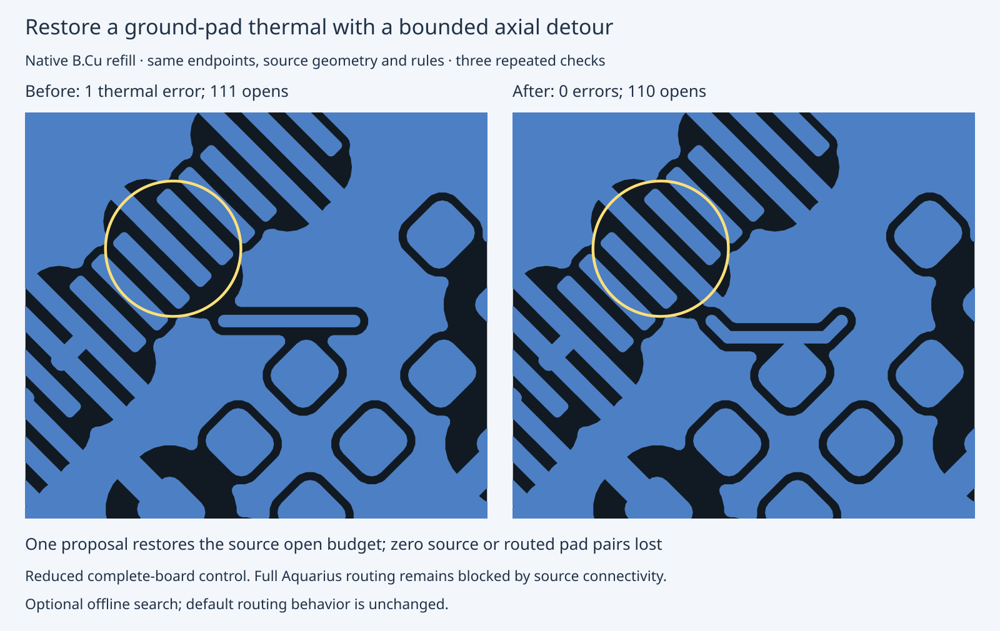

# Select bounded axial thermal repair tools

The engine pin moves from `e411a8ae` to `cc1bc212`. Every file in routing `src/`
is byte-identical between these revisions. The selected optional offline tools
add six axial detours after the complete existing diagonal/pair proposal prefix,
without expanding the 304-proposal stage bound or changing acceptance guards.
The default benchmark configuration and live-editor application are unchanged.

A reduced complete-board ground-pad witness now repairs in three repeats:
one thermal error to zero, 111 opens to the source budget of 110, and zero lost
source or routed terminal pairs. The original benchmark input is untouched; only
a separate fixture reidentifies two duplicated outline graphical UUIDs, with all
physical geometry/rules unchanged. This is not a repair of the full Aquarius
output, whose source-connectivity loss remains a blocker.

The full archive, executable snapshots, rules, every native proposal/report,
matched benchmark results, before/after image and independent replay are in
[engine evidence](https://github.com/fabPlane/fab_router/tree/agent/fab-router-native-drc-gate/docs/pr-assets/agent-fab-router-native-drc-gate/c206-axial-thermal).



## Measurements and reproduction

| Scope                                    | Before | After |
| ---------------------------------------- | -----: | ----: |
| Passing runs (26 cases × 3 seeds)        |  45/78 | 45/78 |
| Cases valid 3/3                          |     15 |    15 |
| Opens                                    |    120 |   120 |
| New native thermal errors                |     18 |    18 |
| Reduced witness repairs (same board × 3) |    0/3 |   3/3 |
| Reduced witness errors per repeat        |      1 |     0 |
| Reduced witness opens per repeat         |    111 |   110 |

```sh
cd /home/hyper/bench/wt/fr-bugs
mkdir /tmp/c206-before-engine
git archive e411a8ae src tools package.json tsconfig.json LICENSE | tar -x -C /tmp/c206-before-engine
cd /home/hyper/bench/wt/fp-bugs
python3 packages/router/bench/native-thermal-config.py --engine /tmp/c206-before-engine --out /tmp/c206-before-config
python3 packages/router/bench/native-thermal-config.py --engine /home/hyper/bench/wt/fr-bugs --out /tmp/c206-after-config
taskset -c 20-25 nice -n 10 timeout --kill-after=10s 7200s python3 benchmarks/autorouter/benchmark.py --router fab-router --fab-router-source /home/hyper/bench/wt/fr-bugs --config-dir /tmp/c206-before-config --out /tmp/c206-before
taskset -c 20-25 nice -n 10 timeout --kill-after=10s 7200s python3 benchmarks/autorouter/benchmark.py --router fab-router --fab-router-source /home/hyper/bench/wt/fr-bugs --config-dir /tmp/c206-after-config --out /tmp/c206-after
env -u KICAD_CLI FAB_ROUTER_MODULE=/home/hyper/bench/wt/fr-bugs/src/api.ts FAB_ROUTER_NATIVE_SEARCH_SOURCE=/home/hyper/bench/wt/fr-bugs bun run --cwd packages/router typecheck
env -u KICAD_CLI FAB_ROUTER_MODULE=/home/hyper/bench/wt/fr-bugs/src/api.ts FAB_ROUTER_NATIVE_SEARCH_SOURCE=/home/hyper/bench/wt/fr-bugs bun run --cwd packages/router test
```
