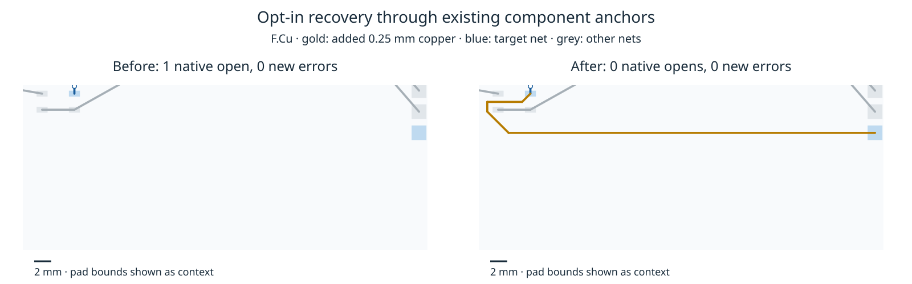

# Optional component recovery pin

Updates the proposed engine pin from `c9f946dca2b9126dd5d17ccf6d8a93b64c44dd11` to `8e53e7d64d78485ee54beba0bf25901d4cd12508`. The existing boolean `RouteOptions.extra.localRecovery` stays optional and off by default. No adapter implementation changes accompany this increment. The engine adds a bounded fallback through existing points in the original terminals' live components, after the original point pair exhausts its local regions. All pairs share one work/deadline budget and preserve original-terminal, retained-copper and exact-geometry gates.

Fresh full native measurements use the same 26 frozen cases × three repeats/source, checker 10.0.6, host, cores 12–19 and public recovery flag enabled in both modes. The measured before snapshot's 98 runtime/type/tool/package files match the previous pin exactly; all 99 after files match the new pin. See [source identity](source-audit.json) and [pin metadata](pin.json).

| Enabled source     | Passed /78 | Valid /26 | Opens | Known new errors |       Median / p95 s |    Total s | Vias | Length sum mm |
| ------------------ | ---------: | --------: | ----: | ---------------: | -------------------: | ---------: | ---: | ------------: |
| Prior proposed pin |         42 |        14 |    96 |               27 | 1.329552 / 19.184059 | 458.374824 | 2826 |  60129.943370 |
| Updated pin        |         48 |        16 |    90 |               27 | 1.386415 / 21.092039 | 484.539243 | 2826 |  60450.378202 |

Only the two sprinkler tasks change, each from 0/3 to 3/3 passes. Each changed run closes its last native open with six 0.25 mm segments, +53.405805 mm and no vias. All existing native segments/vias remain; 72/78 session files are unchanged. Zero introduced structured error/warning geometry, fidelity or completion regressions. The 27 known errors remain unresolved. Aggregate observed time rises 5.7%; sequential sweeps overlap other test/stress jobs. No causal speed gain or default promotion is claimed.



[Complete per-case/larger/acceptance results](results.md), [native comparison](native-comparison.json), [native copper audit](native-copper-audit.json), [profile summary](profile-summary.json). Full raw changed native boards, source scripts, CPU profile, licenses, checks, archives and exact reproduction are in the [engine evidence](https://github.com/fabPlane/fab_router/blob/agent/fab-router-perf-local-rescue/docs/pr-assets/agent-fab-router-perf-local-rescue/point-components/README.md).

Package typecheck and 97 unit tests pass with one optional runtime skip and zero failures against the pinned runtime bytes (`package-final-checks.txt`). Engine typecheck/layers and all 912 tests pass. Live editor integration remains unvalidated after the earlier local startup failure.

Prepared native Dense6 has the same 181 opens/run and zero new errors in all three paired repeats, with identical sessions, vias and lengths. Its supervisor returned143 after all six records were written; every recorded routing/check step exited zero without timeout. That status is retained in `dense-supervisor.json`. The larger DSN controls also retain identical sessions and exact quality. Slow acceptance keeps its existing expectations and reports failed cases; see the complete results rather than treating it as an all-pass claim.

## Reproduce

With dependencies and the local benchmark runtime already installed, use a new output directory. The source snapshot helper forces only the public recovery flag through an API shim; the frozen case settings and rules are unchanged.

```bash
ENGINE=/home/hyper/bench/wt/fr-perf
BENCH=/home/hyper/bench/wt/fp-perf
ASSET="$ENGINE/docs/pr-assets/agent-fab-router-perf-local-rescue/point-components"
OUT=/home/hyper/bench/agents/codex-fabpcb-perf/scratch/repro42-consumer
python3 "$ASSET/snapshot.py" "$ENGINE" "$OUT"
cd "$BENCH"
for MODE in before after; do
  taskset -c 12-19 nice -n 10 timeout 2400 python3 benchmarks/autorouter/benchmark.py --router fab-router --fab-router-source "$OUT/$MODE/entry" --out "$OUT/native-$MODE"
done
python3 "$ASSET/compare-native.py" "$OUT/native-before" "$OUT/native-after" "$OUT/native-comparison.json"
cd "$BENCH/packages/router"
taskset -c 12-19 nice -n 10 bun run typecheck
FAB_ROUTER_MODULE="$OUT/after/src/api.ts" taskset -c 12-19 nice -n 10 bun test $(rg --files test -g '*.test.ts' -g '!router.kicad.test.ts')
```

`source-audit.json` binds the pin to the frozen runtime bytes in these commands. The source helper records original revisions/hashes alongside its synthetic local snapshot commits. Earlier optional-recovery stages remain documented in the sibling historical evidence directories.
