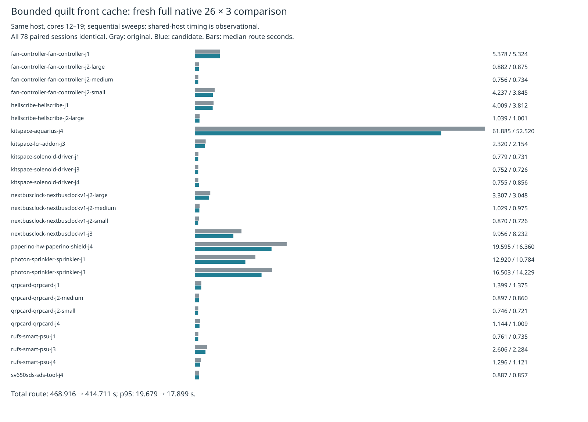

# Quilt front-cache engine pin update

This increment advances the proposed engine pin from `8e53e7d64d78485ee54beba0bf25901d4cd12508` to `790256b1358406c2c2e9c16788f7586cd7ad4808`. It depends on [engine PR37](https://github.com/fabPlane/fab_router/pull/37). Adapter behavior and the optional recovery setting are unchanged by this pin increment. Recovery remains off by default.

`pin-source-audit.json` verifies every one of the 1,501 pinned source/spec/tool/package/config files against the freshly measured original engine. All are byte-identical. Only `src/route/quilt.ts` changes in the candidate. Tests are excluded from this runtime identity statement; a later engine test extension does not change the runtime. The native wrappers enable local recovery identically in both sources. This is an engine API comparison, not an adapter exporter or live-editor benchmark.

Fresh original then candidate sweeps use the same 26 frozen cases × three repeats on the same host, cores 12–19, nice 10, without overlapping own heavy jobs. Summed route time falls 11.56%, aggregate median 9.50%, and p95 9.05%. All 78 paired sessions and final engine statistics are identical. Passes, opens, native findings, vias and length do not regress. Known 27 native thermal errors remain unresolved. The sequential shared-host observations do not prove a causal speed effect and are not an every-case gain: one median and two p95 values increase.

| Full native metric (26 cases × 3 repeats) | Original | Front cache |
|---|---:|---:|
| Passed / 78 | 48 | 48 |
| Valid cases / 26 | 16 | 16 |
| Opens | 90 | 90 |
| New native errors (known, unresolved) | 27 | 27 |
| Median route seconds | 1.167854 | 1.056879 |
| p95 route seconds | 19.679421 | 17.899242 |
| Sum route seconds | 468.916279 | 414.710726 |
| Sweep wall seconds | 587.954642 | 528.184038 |
| Sum case medians seconds | 156.709248 | 135.894560 |
| Sum case p95 seconds | 161.892035 | 145.235971 |
| Sum vias | 2826 | 2826 |
| Sum length mm | 60450.378202 | 60450.378202 |

[All case timings and native results](table.md), [summary](summary.json), and [paired comparison](comparison.json) retain the data. Lossless raw checks, settings, sessions, source inventories, licenses, supervisor exits and archive verifiers are committed with the [engine evidence](https://github.com/fabPlane/fab_router/tree/790256b1358406c2c2e9c16788f7586cd7ad4808/docs/pr-assets/agent-fab-router-perf-local-rescue/quilt-front-native).



Exact engine reproduction commands are in the [engine prerequisite README](https://github.com/fabPlane/fab_router/blob/790256b1358406c2c2e9c16788f7586cd7ad4808/docs/pr-assets/agent-fab-router-perf-local-rescue/quilt-front/README.md). Each native sweep runs from the benchmark checkout:

```sh
taskset -c 12-19 nice -n 10 timeout --kill-after=5 3000 python3 benchmarks/autorouter/benchmark.py --router fab-router --fab-router-source SOURCE/entry --out OUTPUT
```

`SOURCE/entry/src/api.ts` wraps the immutable source solely to enable existing `localRecovery:true` identically. Pinned old source and measured control identity are checked by SHA-256 in `pin-source-audit.json`; the adapter itself does not participate in this timing measurement.

Package checks, with the pinned runtime explicitly selected:

```sh
bun run --cwd packages/router typecheck
cd packages/router
FAB_ROUTER_MODULE=/home/hyper/bench/wt/fr-perf/src/api.ts bun test $(rg --files test -g '*.test.ts' -g '!router.kicad.test.ts')
```

Native editor integration remains unvalidated after the previously documented local startup failure; its test is excluded explicitly, with no changes to expectations or gating. Frozen inputs, rules, scoring, checker and shared runtime are unchanged.

Completed additional validation: dense native one paired repeat with identical sessions, 181 opens, zero new native errors, 315 vias and 2317.561458 mm length. Dense route time rises 160.963 → 177.181 seconds (+10.08%); this negative single observation is retained. L2/L3 paired engine replays have exact sessions/statistics/reports except time, 21/153 incomplete connections and zero added engine violations. Times are 19.729 → 19.963 and 177.275 → 177.825 seconds. Ladder results have no fresh native score.

The complete enabled slow sweep evaluates all 63 unchanged acceptance cases: 51 pass, 12 retain recorded failures, 14 advisory results, no stubs and zero adverse completion/added-violation/invariant changes relative to the historical matching-pin control. This is a fresh candidate sweep against a historical control, not fresh paired slow timing; its 2420.617 seconds versus historical 2488.515 seconds is not a causal speed claim. All 99 captured historical runtime files match the measured original, and acceptance tools/fixtures are unchanged from that pin.

Package typecheck and explicitly scoped unit checks pass: 97 pass, one optional jar-runtime skip, zero failures, 379 assertions. `package-checks.log.gz` and `package-exit.json` retain exact output and exit 0. Both engine modes passed all 912 unit tests. The engine's subsequent stress archive independently replays the additional checks and rejects three corrupted evidence controls.

```sh
PYTHONDONTWRITEBYTECODE=1 python3 docs/pr-assets/agent-router-perf-public-recovery/quilt-front/verify-pin.py "$HOME/bench/wt/fr-perf"
```
