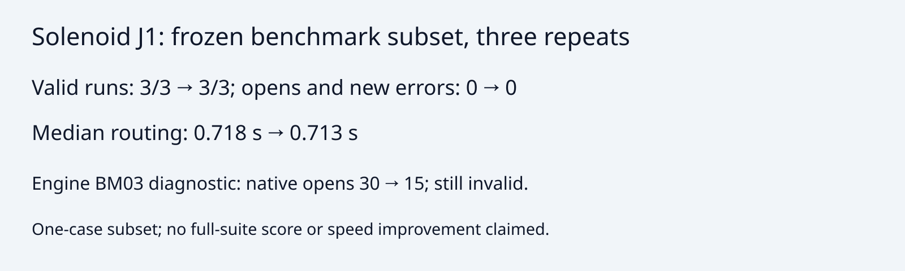

# Adopt barrel component preservation

The pin advances from 69cf598 to 5c893d824b1a2ea649536980d18e2b48a30cafbd, which rejects barrel removals
that split surviving copper components. Engine PR: https://github.com/fabPlane/fab_router/pull/39.

The engine BM03 diagnostic reduces native opens from 30 to 15 in each of three
repeats with all 142 non-open error findings unchanged; BM03 remains invalid.
Track shortening still uses its existing acceptance rule.

Frozen standalone benchmark, hyper-ms-lin cores 6–11, stock KiCad 10.0.6,
solenoid-driver J1, three repeats each (subset, not a full-suite score):

| Metric                              | Before | After |
| ----------------------------------- | -----: | ----: |
| Valid runs                          |    3/3 |   3/3 |
| Opens / new DRC errors, each repeat |  0 / 0 | 0 / 0 |
| Median routing seconds              |  0.718 | 0.713 |

No speed improvement is claimed. Inputs, checker and frozen scoring are unchanged.
Benchmark source override uses the exact pinned candidate; a local copied runtime
keeps the reference runtime read-only.

From this repository root, with runtime installed and the two engine checkouts:

```sh
nice -n 10 taskset -c 6-11 timeout 600s python3 benchmarks/autorouter/benchmark.py --router fab-router --case kitspace-solenoid-driver-j1 --fab-router-source /path/to/baseline-69cf598 --out /tmp/barrel-pin-before
nice -n 10 taskset -c 6-11 timeout 600s python3 benchmarks/autorouter/benchmark.py --router fab-router --case kitspace-solenoid-driver-j1 --fab-router-source /path/to/candidate-5c893d824b1a2ea649536980d18e2b48a30cafbd --out /tmp/barrel-pin-after
bun run --cwd packages/router typecheck
FAB_ROUTER_MODULE=/path/to/candidate-5c893d824b1a2ea649536980d18e2b48a30cafbd/src/api.ts bun test packages/router/test/fab-router.test.ts
```

Router typecheck and 10 adapter tests / 38 assertions pass. Engine typecheck,
layer checks and full tests pass in the engine PR. PNG visually inspected.


