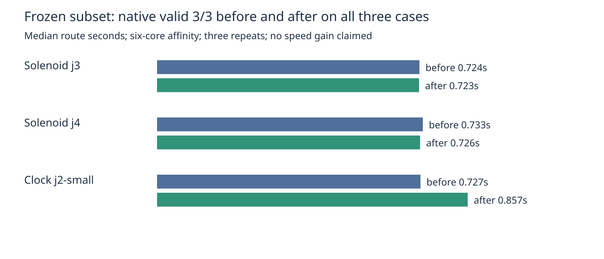

# Broader frozen regression subset

Compared unchanged baseline 69cf598db98c136bff16bbe02bccdded95674b18 with
candidate 5c893d824b1a2ea649536980d18e2b48a30cafbd on hyper-ms-lin,
cores 6–11, stock native KiCad 10.0.6. Three repeats per revision per case.
All 18 initial attempts passed native acceptance, fidelity and task-specific checks.
Each had zero opens and zero new DRC errors. Via counts and lengths were identical.
This is a subset, not a full-suite score or a speed improvement claim.

| Case | Valid before / after | Median seconds before / after | Vias before / after | Length mm before / after |
|---|---|---|---|---|
| Solenoid J3 power widths | 3/3 / 3/3 | 0.724 / 0.723 | 12 / 12 | 354.176 / 354.176 |
| Solenoid J4 ground pour | 3/3 / 3/3 | 0.733 / 0.726 | 9 / 9 | 239.685 / 239.685 |
| Clock J2 small retained copper | 3/3 / 3/3 | 0.727 / 0.857 | 2 / 2 | 1498.273 / 1498.273 |

The initial clock measurement is 18% slower. These short wall-time samples include
export/import overhead and shared-host load. A reversed-order confirmation is
recorded separately; neither set should be omitted when assessing runtime risk.
Frozen inputs, checker, scoring and settings were not changed. Input manifest and
harness hashes match; all runs preserve controls. measurements.json contains all
18 results, revision ids, evidence hashes and harness identity.

Reproduce from the repository root with the runtime installed (the before command
uses its checksum-verified baseline source). Candidate is an unchanged checkout
of the exact revision above:

```sh
nice -n 10 taskset -c 6-11 timeout 1800s python3 benchmarks/autorouter/benchmark.py --router fab-router --case kitspace-solenoid-driver-j3 --case kitspace-solenoid-driver-j4 --case nextbusclock-nextbusclockv1-j2-small --out /tmp/barrel-subset-before
nice -n 10 taskset -c 6-11 timeout 1800s python3 benchmarks/autorouter/benchmark.py --router fab-router --case kitspace-solenoid-driver-j3 --case kitspace-solenoid-driver-j4 --case nextbusclock-nextbusclockv1-j2-small --fab-router-source /path/to/candidate-5c893d824b1a2ea649536980d18e2b48a30cafbd --out /tmp/barrel-subset-after
python3 docs/pr-assets/agent/barrel-components-pin/cycle173/summarize.py /tmp/barrel-subset-before /tmp/barrel-subset-after
bun run --cwd packages/router typecheck
FAB_ROUTER_MODULE=/path/to/candidate-5c893d824b1a2ea649536980d18e2b48a30cafbd/src/api.ts bun test packages/router/test/fab-router.test.ts
```

Adapter typecheck and 10 tests / 38 assertions pass. Chart requires rsvg-convert;
no additional Python packages. PNG visually inspected.



Reversed-order confirmation, same clock case, another three repeats per revision:
all six passed with the same quality metrics. Median before 0.721192s, after
0.720758s. The initial 18% increase did not repeat; timing remains inconclusive.
All 24 attempts from this cycle are retained, without selecting the faster set.

```sh
nice -n 10 taskset -c 6-11 timeout 600s python3 benchmarks/autorouter/benchmark.py --router fab-router --case nextbusclock-nextbusclockv1-j2-small --fab-router-source /path/to/candidate-5c893d824b1a2ea649536980d18e2b48a30cafbd --out /tmp/barrel-clock-after2
nice -n 10 taskset -c 6-11 timeout 600s python3 benchmarks/autorouter/benchmark.py --router fab-router --case nextbusclock-nextbusclockv1-j2-small --out /tmp/barrel-clock-before2
python3 docs/pr-assets/agent/barrel-components-pin/cycle173/summarize.py /tmp/barrel-subset-before /tmp/barrel-subset-after /tmp/barrel-clock-after2 /tmp/barrel-clock-before2
```
