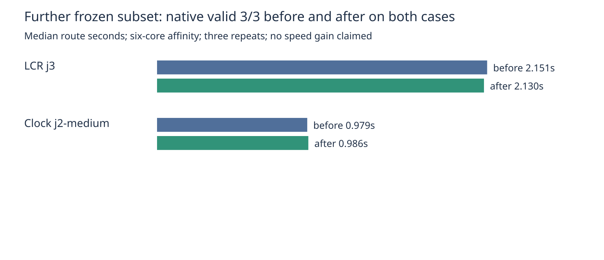

# Additional native regression coverage

Unchanged baseline 69cf598db98c136bff16bbe02bccdded95674b18 versus candidate
5c893d824b1a2ea649536980d18e2b48a30cafbd, hyper-ms-lin cores 6–11,
stock KiCad 10.0.6, three repeats per case per revision. All 12 attempts passed.
Zero native opens/new errors; fidelity and frozen controls preserved throughout.
This is a subset measurement, not a full-suite result or speed gain claim.

| Case | Valid before / after | Median seconds before / after | Vias before / after | Length mm before / after |
|---|---|---|---|---|
| LCR power widths J3 | 3/3 / 3/3 | 2.150534 / 2.129880 | 40 / 40 | 845.486 / 845.486 |
| Clock retained copper J2 medium | 3/3 / 3/3 | 0.978534 / 0.985627 | 1 / 1 | 1484.105 / 1484.105 |

No engine, adapter, frozen inputs, checker or scoring edits. measurements.json
retains every attempt and input/harness/raw evidence identities. The summary
script asserts completion, native success, controls and matching six-core affinity.
Adapter typecheck and 10 tests / 38 assertions passed. PNG visually inspected.

From the repository root, with installed pinned runtime and exact candidate checkout:

```sh
nice -n 10 taskset -c 6-11 timeout 1800s python3 benchmarks/autorouter/benchmark.py --router fab-router --case nextbusclock-nextbusclockv1-j2-medium --case kitspace-lcr-addon-j3 --out /tmp/additional-before
nice -n 10 taskset -c 6-11 timeout 1800s python3 benchmarks/autorouter/benchmark.py --router fab-router --case nextbusclock-nextbusclockv1-j2-medium --case kitspace-lcr-addon-j3 --fab-router-source /path/to/candidate-5c893d824b1a2ea649536980d18e2b48a30cafbd --out /tmp/additional-after
python3 docs/pr-assets/agent/barrel-components-pin/cycle174/summarize.py /tmp/additional-before /tmp/additional-after
bun run --cwd packages/router typecheck
FAB_ROUTER_MODULE=/path/to/candidate-5c893d824b1a2ea649536980d18e2b48a30cafbd/src/api.ts bun test packages/router/test/fab-router.test.ts
```


