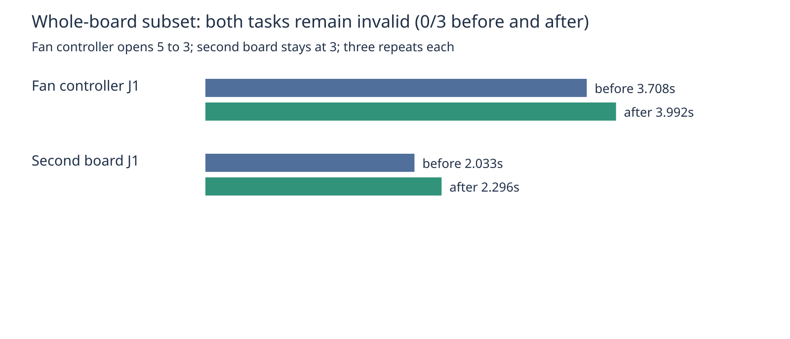

# Whole-board native regression measurement

Unchanged baseline 69cf598db98c136bff16bbe02bccdded95674b18 versus candidate
5c893d824b1a2ea649536980d18e2b48a30cafbd, hyper-ms-lin cores 6–11,
stock KiCad 10.0.6. Three repeats per case per revision; all 12 attempts checked.
Both tasks remain invalid in every repeat. No full-suite or speed improvement claim.

| Case                  | Valid before / after | Opens before / after, each repeat | New errors before / after | Median seconds before / after | Vias before / after |
| --------------------- | -------------------- | --------------------------------- | ------------------------- | ----------------------------- | ------------------- |
| Fan controller J1     | 0/3 / 0/3            | 5 / 3                             | 0 / 0                     | 3.707934 / 3.992332           | 102 / 104           |
| Second whole board J1 | 0/3 / 0/3            | 3 / 3                             | 0 / 0                     | 2.032837 / 2.296248           | 100 / 100           |

Fan-controller length remains 909.022035 mm; second-board length remains
1315.786056 mm. Candidate times are approximately 8% and 13% higher in this
measurement. Shared-host timing alone does not establish a stable slowdown;
these samples are retained without selecting faster reruns. The fan-controller
connectivity improvement costs two additional vias and does not close the task.
Fidelity, project/custom rules, frozen inputs and harness controls are preserved.
Warnings are recorded in measurements.json and remain distinct from scored errors.
No engine, adapter, input, checker or scoring edits were made this cycle.

Reproduce from the repository root with installed checksum-verified baseline runtime
and an unchanged checkout of the candidate revision:

```sh
nice -n 10 taskset -c 6-11 timeout 1800s python3 benchmarks/autorouter/benchmark.py --router fab-router --case fan-controller-fan-controller-j1 --case hellscribe-hellscribe-j1 --out /tmp/whole-before
nice -n 10 taskset -c 6-11 timeout 1800s python3 benchmarks/autorouter/benchmark.py --router fab-router --case fan-controller-fan-controller-j1 --case hellscribe-hellscribe-j1 --fab-router-source /path/to/candidate-5c893d824b1a2ea649536980d18e2b48a30cafbd --out /tmp/whole-after
python3 docs/pr-assets/agent/barrel-components-pin/cycle175/summarize.py /tmp/whole-before /tmp/whole-after
bun run --cwd packages/router typecheck
FAB_ROUTER_MODULE=/path/to/candidate-5c893d824b1a2ea649536980d18e2b48a30cafbd/src/api.ts bun test packages/router/test/fab-router.test.ts
```

Summary validates three distinct seeds per case, completion, native integrity,
controls and matching six-core affinity while preserving failed attempts.
It records exact input/harness hashes, revision and all raw summary file hashes.
Adapter typecheck and 10 tests / 38 assertions passed. Chart uses rsvg-convert.
An overlapping initial candidate launch hit the harness lock before creating output;
only the sequential retry routed boards. No attempt was dropped or replaced.


