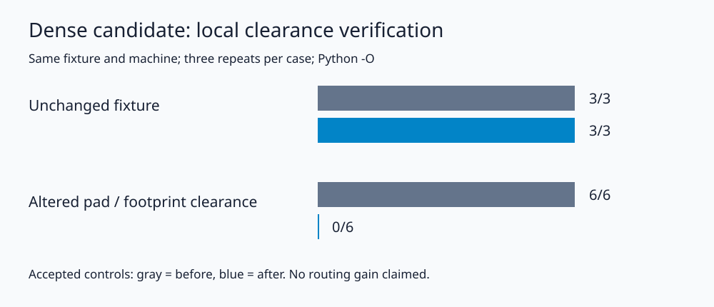

The candidate verifier could accept a native board with changed pad or footprint clearance overrides while reporting geometry and rule equivalence. Include each local clearance override in the native signature, preserving the difference between inherited rules and explicit zero. Add a regression test for unset, zero, 0.05 mm and 0.1 mm values and a repeatable end-to-end mutation measurement.

The existing verifier also checks deterministic generation, native geometry, project/default rules, exported DSN equivalence and unrouted DRC. The candidate stays outside the frozen suite and retains its promotion gate.

Measured on hyper-ms-lin, cores 0–5, nice 10, KiCad 10.0.6; Python `-O`, same seed-6406 board and machine, three repeats per case. Before is `165fd03`; after is this branch:

| Candidate verification benchmark | Before accepted | After accepted | Repeats per case |
|---|---:|---:|---:|
| Unchanged candidate | 3/3 | 3/3 | 3 |
| Pad clearance overridden to 0.05 mm | 3/3 | 0/3 | 3 |
| Footprint clearance overridden to 0.05 mm | 3/3 | 0/3 | 3 |

All accepted unchanged fixtures have 0 native errors, 439 opens and 30 generated-footprint library warnings. Altered controls reject at the native-signature comparison before export/DRC. The previous verifier accepted those controls even after its native DRC. These are constructed admission controls; no routing, speed or feasibility improvement is claimed. Unit tests exercise explicit zero as well as positive overrides. Other native properties omitted by the signature remain outside this fix.

Typecheck, all 11 unit packages and nine Python test methods pass. The first unit invocation lacked the local router module path and passed 10/11 packages; the documented configured invocation passes 11/11. No layer-check script exists. Frozen cases, scoring and engine code are unchanged.

Reproduce (use a fresh output directory):

```sh
git show 165fd03:benchmarks/boards/dense6-bga324/verify_dense6.py > /tmp/dense6-before54.py
nice -n 10 taskset -c 0-5 timeout 1800 /usr/bin/python3 \
  benchmarks/boards/dense6-bga324/measure_clearance_dense6.py \
  --before /tmp/dense6-before54.py \
  --after benchmarks/boards/dense6-bga324/verify_dense6.py \
  --generator benchmarks/boards/dense6-bga324/gen_dense6.py \
  --fixture benchmarks/boards/dense6-bga324 \
  --out /tmp/dense6-clearance54
nice -n 10 taskset -c 0-5 timeout 180 /usr/bin/python3 -O -m unittest discover \
  -s benchmarks/boards/dense6-bga324 -p test_verify_dense6.py
nice -n 10 taskset -c 0-5 timeout 180 bun run typecheck
FAB_ROUTER_MODULE=$HOME/bench/repos/fab_router/src/api.ts \
  nice -n 10 taskset -c 0-5 timeout 180 bun run test:unit
```



[Existing optimization checks](https://github.com/fabPlane/fab_pcb/blob/agent/dense-candidate-verification/docs/pr-assets/agent/dense-candidate-verification/OPTIMIZATION.md) and committed `clearance-controls.json` retain earlier and current evidence. The verifier compares selected native fields; it is not a complete serialization identity or a routability certificate.
