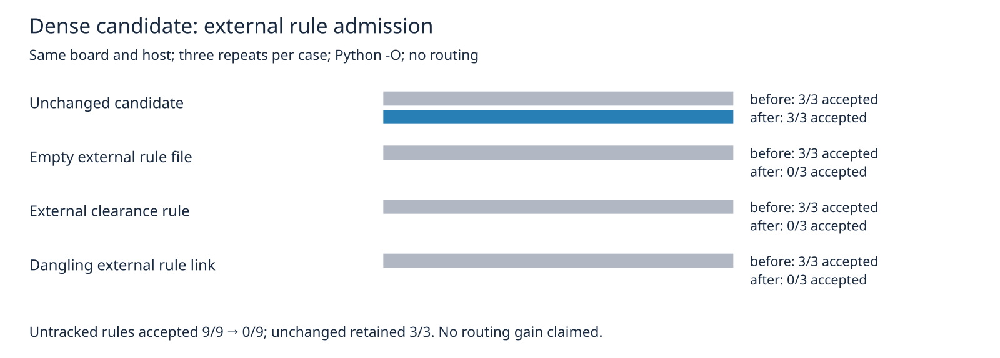

The dense candidate verifier copied the board and project but silently dropped a supplied custom-rule sidecar before checking it. The verifier now rejects `.kicad_dru` companions beside the supplied board or either generated board. This fixed candidate requires absent custom rules; empty files, directories and dangling links reject too. Earlier project-policy and local-clearance guards remain in place.

The candidate remains outside the frozen autorouter suite. No router, scoring or frozen-case changes. Selected geometry and project policy checks do not establish complete native identity; production baseline adoption remains pending.

Same seed-6406 board, hyper-ms-lin, cores 0–5, nice 10, Python `-O`, native checker 10.0.6. Three repeats per case; before `03fee44`, after this branch:

| Candidate admission benchmark | Before accepted | After accepted | Repeats per case |
|---|---:|---:|---:|
| Unchanged candidate | 3/3 | 3/3 | 3 |
| Empty custom-rule file | 3/3 | 0/3 | 3 |
| Active custom clearance rule | 3/3 | 0/3 | 3 |
| Dangling custom-rule link | 3/3 | 0/3 | 3 |

All unchanged controls retain 0 native errors, 439 opens and 30 library warnings. The previous verifier checked a copy without the custom rules; these results do not establish DRC behavior with the original sidecar present. This is an admission fix with no routing, speed or feasibility gain.

Typecheck, all eleven unit packages and eleven Python methods pass. No layer-check script exists. Full records are committed as `custom-rule-controls.json` alongside the image.

Exact reproduction in fresh output directories:

```sh
git show 03fee44:benchmarks/boards/dense6-bga324/verify_dense6.py > /tmp/dense6-before56.py
nice -n 10 taskset -c 0-5 timeout 1200 /usr/bin/python3 \
  benchmarks/boards/dense6-bga324/measure_custom_rules_dense6.py \
  --before /tmp/dense6-before56.py \
  --after benchmarks/boards/dense6-bga324/verify_dense6.py \
  --generator benchmarks/boards/dense6-bga324/gen_dense6.py \
  --fixture benchmarks/boards/dense6-bga324 --out /tmp/dense6-custom-rules56
nice -n 10 taskset -c 0-5 timeout 180 /usr/bin/python3 -O -m unittest discover \
  -s benchmarks/boards/dense6-bga324 -p test_verify_dense6.py
nice -n 10 taskset -c 0-5 timeout 180 bun run typecheck
FAB_ROUTER_MODULE=$HOME/bench/repos/fab_router/src/api.ts \
  nice -n 10 taskset -c 0-5 timeout 240 bun run test:unit
```


