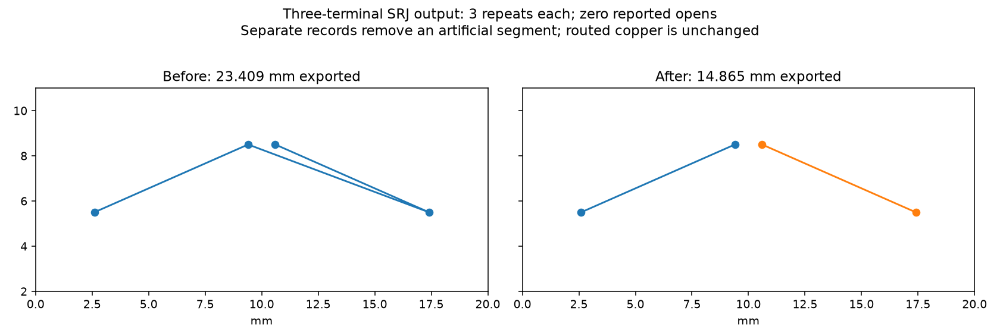

Pin fab_router to `b9fb8c8f3ac11c0db161fa81ff23982304ec3be0` for the separate copper-item serializer repair. This is a companion to the engine change; the adapter uses the native DSN path, whose checked geometry remains unchanged.

When a connection has multiple tracks, concatenating their corners invents segments between those tracks. Export one record per track and one standalone record per barrel, keeping the owner and a deterministic item-specific ID. This implements the existing J-41–J-43 output contract. Trace IDs now identify physical items; consumers must group by connection_name rather than assume one record per connection.

Measured on hyper-ms-lin, cores 6–11, nice 10, three repeats per mode, baseline 69cf598 versus the source change in this branch:

| Case | Before | After |
| --- | --- | --- |
| Three-terminal SRJ: exported length | 23.408727 mm | 14.864723 mm |
| Three-terminal SRJ: output records / reported opens | 1 / 0 | 2 / 0 |
| Native solenoid J1: valid repeats | 3/3 | 3/3 |
| Native solenoid J1: opens / new errors | 0 / 0 | 0 / 0 |
| Native solenoid J1: vias / copper length | 12 / 352.690597 mm | 12 / 352.690597 mm |
| Native solenoid J1: median route seconds | 0.897248 | 0.738679 |

The SRJ length difference removes an artificial 8.544004 mm export segment. Routed copper and routing completion are unchanged. Native solenoid checks exercise the separate DSN/session path; they do not prove native import or physical validity of SRJ output. Timings overlapped other validation; no speed claim. This is a subset qualification, not a full-suite improvement. The original diagnostic fixture is MIT; engine code retains the repository GPL-3.0 license.



Reproduce from the engine repository (BASELINE is a checkout at 69cf598):

```sh
nice -n 10 taskset -c 6-11 timeout 120 bun run typecheck
nice -n 10 taskset -c 6-11 timeout 120 bun run check:layers
nice -n 10 taskset -c 6-11 timeout 600 bun run test
nice -n 10 taskset -c 6-11 timeout 90 bun docs/pr-assets/agent/srj-copper-runs/measure.ts "$BASELINE" > /tmp/srj-before.json
nice -n 10 taskset -c 6-11 timeout 90 bun docs/pr-assets/agent/srj-copper-runs/measure.ts . > /tmp/srj-after.json
```

From a prepared companion repository checkout, use unchanged frozen cases/checker/configuration and an owned runtime copy:

```sh
PYTHONDONTWRITEBYTECODE=1 nice -n 10 taskset -c 6-11 timeout 300 python3 benchmarks/autorouter/benchmark.py --router fab-router --case kitspace-solenoid-driver-j1 --fab-router-source "$BASELINE" --out /tmp/native-before
PYTHONDONTWRITEBYTECODE=1 nice -n 10 taskset -c 6-11 timeout 300 python3 benchmarks/autorouter/benchmark.py --router fab-router --case kitspace-solenoid-driver-j1 --fab-router-source "$CANDIDATE" --out /tmp/native-after
```

native-consumer/samples.json contains actual routeSrj results; native-summary.json records the independent native subset comparison. The image is generated from those actual before/after SRJ results.

This companion pins the serializer repair and offers the original fixture outside the frozen suite. Engine regression and native DSN subset results are distinct; the native-consumer subdirectory now qualifies the narrow three-terminal top-copper fixture. General native SRJ consumption remains unqualified.

Adapter validation: package typecheck passes; focused adapter suite 10 passed, zero failed, 38 assertions. Engine suite: 861 passed, zero failed; layer check zero violations.
