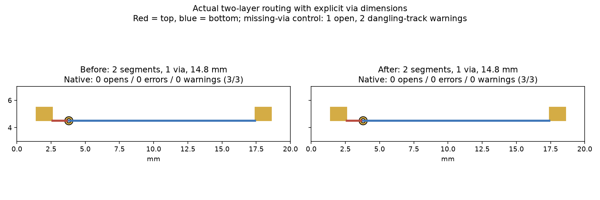

Native qualification of actual two-layer SRJ routing with explicit via dimensions. The earlier cycle475 fixture omitted via dimensions; the SRJ builder consequently created no via form. This original MIT variant supplies a 0.6 mm pad and 0.3 mm drill. It is outside the frozen suite.

Same fixture, hyper-ms-lin, cores 6–11, nice 10, three routing repeats per serializer followed by native 10.0.6 save/reload/DRC with unchanged default rules:

| Measurement | Before serializer | Repaired serializer |
| --- | --- | --- |
| Engine reported opens | 0 each | 0 each |
| Native valid repeats | 3/3 | 3/3 |
| Native opens / errors / warnings | 0 / 0 / 0 each | 0 / 0 / 0 each |
| Imported planar segments / vias | 2 / 1 | 2 / 1 |
| Imported planar length | 14.8 mm | 14.8 mm |
| Export records | 1 | 3 |

Both revisions generate the same physical copper. The repaired serializer emits two wire records and a standalone via record. The diagnostic consumer imports explicit via steps independently and only adjacent same-layer wire pairs as segments; it never infers copper between records or from a wire to a via step. Dimensions come from the original SRJ fixture because exported via steps omit them. Reloaded via pad/drill, net ownership, segment count and total length are asserted. Dropping the via leaves one open and two dangling-track warnings; the unrouted control has one open and no other findings. Initial zero-warning expectation for the missing-via control was corrected to assert those two native warnings explicitly; checker/rules were unchanged.

Source and input SHA256s are retained in identity.json; native import locks sample and fixture hashes. A separate routing replay produces identical traces, and the self-contained public consumer reproduces the same summary. No engine, production importer, default pin, checker or scoring changes. This is narrow through-via consumer qualification, not a corpus improvement, speed claim, general SRJ importer or zone/blind-via qualification. Earlier branch/native benchmark evidence remains in cycles476–477.

```sh
nice -n 10 taskset -c 6-11 timeout 180 /usr/bin/python3 docs/pr-assets/agent/srj-copper-runs-pin/cycle478/native_consumer.py
nice -n 10 taskset -c 6-11 timeout 120 uv run --with matplotlib python docs/pr-assets/agent/srj-copper-runs-pin/cycle478/chart.py
(cd packages/router && nice -n 10 taskset -c 6-11 timeout 120 bun run typecheck)
nice -n 10 taskset -c 6-11 timeout 120 bun test packages/router/test/fab-router.test.ts
```

Retained inputs make native reproduction self-contained. Source commits and file hashes are in identity.json. Requires pcbnew and kicad-cli 10.0.6. The diagnostic uses --format json --refill-zones --severity-all with a 45-second subprocess deadline. No service or production importer is invoked.


