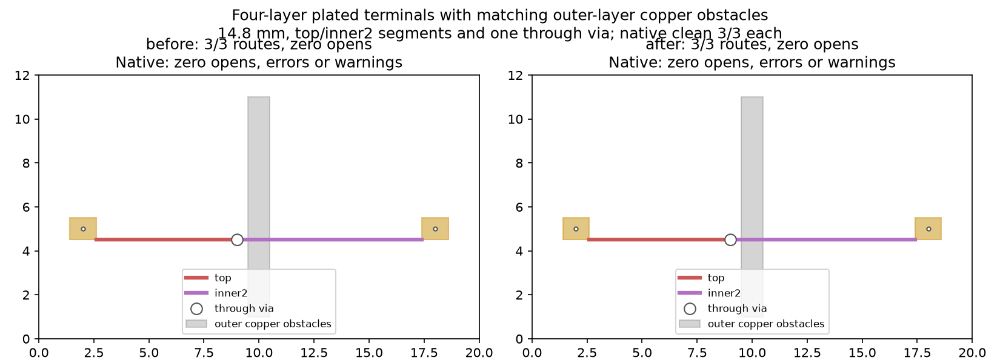

Original MIT four-layer plated-terminal fixture with matched outer-layer copper obstacles. It replaces the invalid inner-only SMD model evaluated in cycle480. Terminal rectangles occupy every copper layer in both SRJ and native boards; native terminals have 0.3 mm plated holes. Separate top/bottom obstacle rectangles belong to separate single-pad nets, matching their layer sets and dimensions in SRJ. Requested inner endpoint labels do not constrain launch layers: the builder recognizes connected terminal copper on every occupied layer. Without the outer obstacles the route uses top copper only. With the obstacles, actual routing uses top and inner2 segments joined by a through via.

Same input and hyper-ms-lin, cores 6–11, nice 10, three fresh routing repeats per serializer. Before is 69cf598db98c136bff16bbe02bccdded95674b18; after is b9fb8c8f3ac11c0db161fa81ff23982304ec3be0. Native 10.0.6 save/reload/refill/DRC uses unchanged default rules.

| Measurement | Before serializer | Repaired serializer |
| --- | --- | --- |
| Engine opens | 0 each | 0 each |
| Native clean repeats | 3/3 | 3/3 |
| Native opens / errors / warnings | 0 / 0 / 0 each | 0 / 0 / 0 each |
| Top + inner2 segments / through vias | 2 / 1 each | 2 / 1 each |
| Planar length | 14.8 mm each | 14.8 mm each |
| Export records | 1 each | 3 each |

The two serializers preserve identical physical copper across every repeat. This expands native consumer qualification to physically valid four-layer terminals and inner-layer copper; it does not show a routing, completion or runtime improvement. Timings are retained observations only. This narrow consumer is not a production importer, full corpus qualification, blind/buried-via or zone qualification. Exported via steps lack dimensions; the consumer takes them from the source fixture (0.6 mm pad, 0.3 mm drill).

Unrouted and missing-via controls each have one native open. The missing-via control also has two dangling-track warnings. All routed repeats have zero warnings. Reload assertions preserve terminal type, drill, dimensions, position, active copper layers, obstacle ownership/geometry, track layers, counts, via span/dimensions and total length. Source and input SHA256s are in identity.json; native consumption locks fixture and sample hashes. Two completed private native sweeps produce the same summary, including a final sweep with stronger pad assertions. No frozen inputs, checker, scoring, engine or default pin changed.

```sh
nice -n 10 taskset -c 6-11 timeout 180 /usr/bin/python3 docs/pr-assets/agent/srj-copper-runs-pin/cycle481/native_consumer.py
nice -n 10 taskset -c 6-11 timeout 120 uv run --with matplotlib python docs/pr-assets/agent/srj-copper-runs-pin/cycle481/chart.py
(cd packages/router && nice -n 10 taskset -c 6-11 timeout 120 bun run typecheck)
nice -n 10 taskset -c 6-11 timeout 120 bun test packages/router/test/fab-router.test.ts
```

Native reproduction is self-contained using retained samples; no service or production importer is invoked. Requires pcbnew/kicad-cli 10.0.6 with default native rules. Each native DRC subprocess has a 45-second timeout and uses --format json --refill-zones --severity-all. Source revisions and hashes are retained in identity.json. Engine source retains GPL-3.0; this original fixture and diagnostic consumer are MIT.


