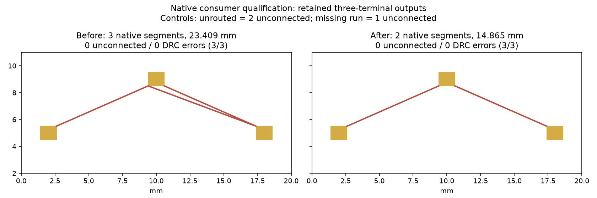

Qualify native consumption of the retained three-terminal SRJ routing outputs. The diagnostic creates three rectangular top-copper pads from the original SRJ obstacles, assigns each trace by connection_name, imports consecutive wire points within each record, saves/reloads the board, and invokes the native checker with unchanged default rules. Trace records are never joined to each other.

Same fixture and machine (hyper-ms-lin, cores 6–11, nice 10), three independently retained route outputs per mode from cycle476; this cycle performs fresh native imports/checks, without new engine routing:

| Native check                       | Before serializer | Repaired serializer |
| ---------------------------------- | ----------------- | ------------------- |
| Imported segments                  | 3                 | 2                   |
| Imported length (mm)               | 23.408727         | 14.864723           |
| Zero-unconnected repeats           | 3/3               | 3/3                 |
| DRC errors / warnings, each repeat | 0 / 0             | 0 / 0               |

Unrouted control has two unconnected items; removing one repaired run has one. Both controls have zero other errors/warnings. All pads/tracks retain NET1 after save/reload. Summary hashes lock the exact fixture and six retained samples. Re-running the checker reproduced the summary. The before output contains the previously measured artificial segment; native checking does not reject redundant same-net copper.

This qualifies this top-copper rectangular-pad fixture with the narrow diagnostic consumer. It is not a general SRJ importer, production application integration, via/zone qualification, or full corpus result. No default router pin, scoring, checker, or engine changes. No routing speed claim. The public companion contains this consumer and self-contained retained inputs.

```sh
nice -n 10 taskset -c 6-11 timeout 180 /usr/bin/python3 docs/pr-assets/agent/srj-copper-runs-pin/native-consumer/native_consumer.py
nice -n 10 taskset -c 6-11 timeout 120 uv run --with matplotlib python docs/pr-assets/agent/srj-copper-runs-pin/native-consumer/chart.py
nice -n 10 taskset -c 6-11 timeout 120 bun run --cwd packages/router typecheck
nice -n 10 taskset -c 6-11 timeout 120 bun test packages/router/test/fab-router.test.ts
```

Requires native checker and pcbnew 10.0.6. The script calls kicad-cli pcb drc --format json --refill-zones --severity-all for each saved board with a 45-second subprocess deadline. Generated project/local-preference files can be discarded; no custom project rules are supplied. Native fixture imports/checks are distinct from the frozen DSN benchmark retained in the parent PR.

Validation: typecheck passes; full harness 268 pass, 28 source-gated skips, zero failures, 6942 assertions. Companion package typecheck and 10 focused adapter tests (38 assertions) pass.


